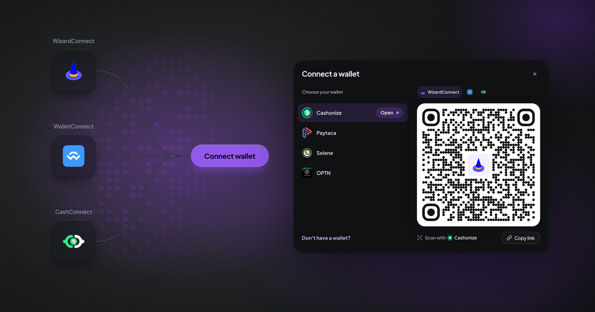

# BCH Connect

BCH Connect is a wallet-connection library for Bitcoin Cash dapps. One
TypeScript API connects your dapp to wallets across connection protocols,
with a built-in modal you can ship as it is or replace with your own UI.

> BCH Connect is in alpha and not yet stable. Expect breaking changes.

- **Any connection protocol, through one client.**.
- **Built-in modal, or your own UI.** A beautiful built-in modal and toast
  that work out of the box, or plug your own UI.
- **Themable and localized.** Eight accents, light and dark modes, and
  presets for radius and font. Every string can be overridden, with English
  and Spanish locales built in.
- **Typed from end to end.**
- **Sessions that last.** Sessions restore on the next visit, and a dapp can
  hold more than one at a time.
- **Framework-agnostic, with support for SSR.** Built in plain TypeScript with
  bindings for frameworks like React.
- **Lightweight, with minimal dependencies.** The core has no runtime
  dependencies, and protocol SDKs load lazily.

## Documentation

To get started, read the docs at [bchconnect.dev](https://bchconnect.dev).

## Packages

| Package | Version | What it is |
| --- | --- | --- |
| [`@bchconnect/core`](packages/core) |  | The client: sessions, requests and errors. |
| [`@bchconnect/connector-walletconnect`](packages/connector-walletconnect) |  | The WalletConnect connector. |
| [`@bchconnect/connector-cashconnect`](packages/connector-cashconnect) |  | The CashConnect connector. |
| [`@bchconnect/ui`](packages/ui) |  | The connect modal and success toast. |

A connector for WizardConnect is planned.

## License

[MIT](LICENSE)
